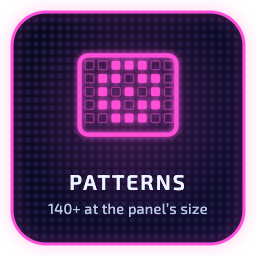
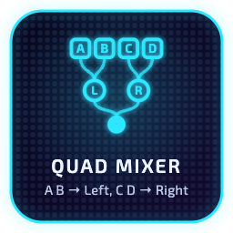
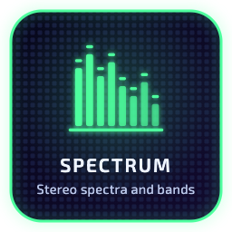
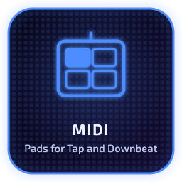
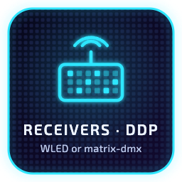
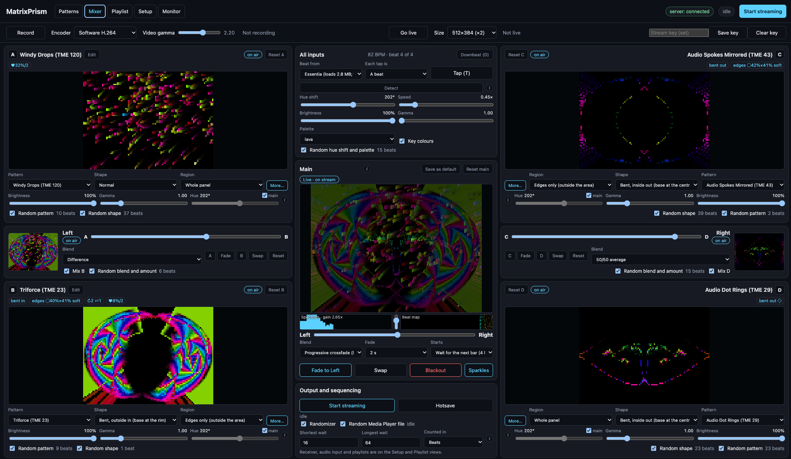
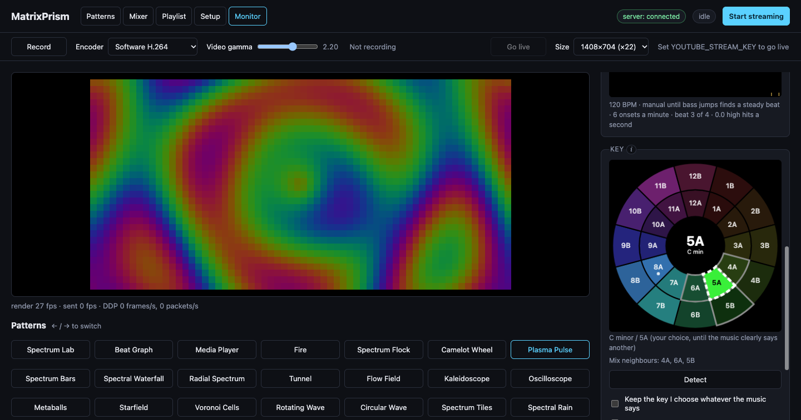
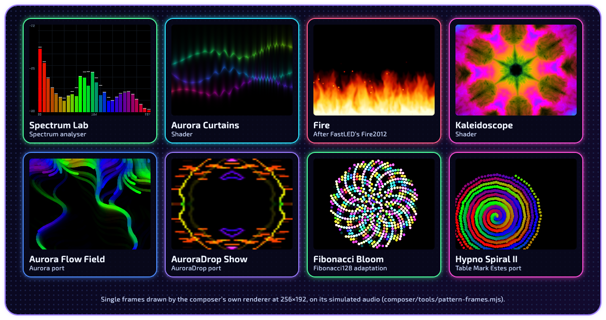

<h1 align="center"></h1>

A real-time composer of music-driven generative visuals for LED panels.

MatrixPrism is a music visualizer that mixes four generated visuals, in two
pairs, into one RGB pixel stream for RGB LED matrix panels, sent over DDP, the
Distributed Display Protocol that WLED speaks. [WLED](https://kno.wled.ge/) 2D
matrix panels are discovered on the local network and sized for output
automatically. Larger panels are supported by MatrixPrism's own receiver,
`matrix-dmx`, which runs on a Raspberry Pi and emulates a WLED node with DDP;
anything else that takes DDP works too. MatrixPrism identifies and tracks
audio features in real time, and patterns use them to evolve and change with
the beat, tempo, key, spectrum and section changes.

```
audio input ─► MatrixPrism app ───────────────────────UDP (DDP)──► DDP receiver ─► LED panel
               (analyse, render, split into packets)               (WLED, matrix-dmx, …)

From the source, the same page runs in a browser with a small server:
audio input ─► browser page ──WebSocket──► Node server ──UDP (DDP)──► DDP receiver ─► LED panel
               (analyse, render)           (split into packets)
```

> **The downloads are not signed yet.** Apple and Microsoft do not yet vouch
> for MatrixPrism's builds: signing waits for an Apple Developer account and
> the SignPath Foundation. So macOS and Windows warn once, before the first
> run; [Quick start](#quick-start) says what to do on each. Every build is made
> and tested by this repository's release workflow. Its `SHA256SUMS` and a
> build attestation (`gh attestation verify <file> --repo
> AnjinMeili/matrixprism`) confirm that a download came from here, unchanged.

It has three parts, each in its own directory:

| Part | Directory | What it is |
|------|-----------|------------|
| **Desktop app** | [`app/`](app) | MatrixPrism for macOS, Windows and Linux: the composer's page in its own window, with the sending built in; only Record and Go live need FFmpeg installed beside it. See [app/README.md](app/README.md) |
| **Composer** | [`composer/`](composer) | The page that analyses audio and renders the patterns, and the relay that sends each frame to the receiver as DDP. From the source it also runs as a browser page with a small Node server. See [composer/README.md](composer/README.md) |
| **Receiver** | [`receiver/`](receiver) | Optional. `matrix-dmx`, which runs on a Raspberry Pi and displays Art-Net, sACN and DDP pixel data from any sender on the matrix, and records and plays back what it displays; and `scene-tool`, which edits those recordings. See [receiver/README.md](receiver/README.md) |

<h2 id="receivers"></h2>

The composer streams to any receiver that takes DDP on UDP port 4048:

- **WLED.** A WLED controller with its LEDs set up as a 2D matrix needs
  nothing installed. The composer finds it on the network, reads its size
  and streams to it. It has been tested with WLED 16 and 17 only: panels of
  32×32 (WLED 16) and 128×64 (WLED 17, on an Adafruit Matrix Portal S3).
- **`matrix-dmx`**, in [`receiver/`](receiver), for HUB75 panels on a
  Raspberry Pi, including panels larger than WLED handles well (such as
  256×192). It answers like a WLED node, so the composer, and apps such as
  LedFx, find it and read its size the same way.
- **Any other DDP receiver**: type its address and set the panel's size by
  hand.

<h2 id="quick-start"></h2>

The composer comes as a desktop app, MatrixPrism, for macOS on Apple silicon,
Windows and Linux. Releases are built and tested by this repository's release
workflow and appear on the [Releases](https://github.com/AnjinMeili/matrixprism/releases)
page. Open the app and choose the receiver under Setup: it finds WLED and
`matrix-dmx` receivers on the network by itself.

The builds are not yet signed, so each system asks once before the first run:

- **macOS:** the app is blocked at first. Open System Settings, Privacy &
  Security, and choose Open Anyway beside MatrixPrism.
- **Windows:** SmartScreen says the publisher is unknown. Choose More info,
  then Run anyway.
- **Any system:** check a download against `SHA256SUMS` on the release page,
  or with `gh attestation verify <file> --repo AnjinMeili/matrixprism`.
- **Linux:** install the `.deb` with `sudo apt install ./MatrixPrism-<version>-<arch>.deb`,
  which also fetches the libraries it needs; `dpkg -i` does not, and the app
  then stops for want of one (`sudo apt -f install` puts that right). The
  AppImage needs those libraries installed already. In a virtual machine, a
  bridged network lets the app find receivers on the LAN.

FFmpeg is a separate install, needed only for Record and Go live (on a Mac,
`brew install ffmpeg`).

### Running from the source

For developing the composer, or on a computer the app does not cover:

```sh
git clone https://github.com/AnjinMeili/matrixprism.git
cd matrixprism/composer
npm start -- --ddp <receiver host>
```

There is no `npm install` step: the composer needs only Node.js 18 or
newer, and the one library its server uses, `ws`, is kept in
`composer/lib/vendor/ws/`. Then open <http://localhost:8080/> and choose the
receiver under Setup. `<receiver host>` is the receiver's IP address or name,
such as `wled-e1f2a3.local`; it can be left out and the receiver chosen in
the page. The desktop app's own sources and build are in [app/](app/README.md).

To use `matrix-dmx` as the receiver, on the Raspberry Pi:

```sh
git clone --recursive https://github.com/AnjinMeili/matrixprism.git
cd matrixprism/receiver
make
sudo ./matrix-dmx
```

The READMEs of the two parts have the options and the details.

<h2 id="what-the-composer-does"></h2>

<p align="center">









</p>

- 148 patterns: audio-reactive shaders, a configurable spectrum analyser, a
  beat graph after BpmDj, a media player for images, GIFs and video, and ports of the Aurora,
  Fibonacci128, Table Mark Estes and AuroraDrop pattern sets and of a 2013
  visualizer demo;
- a quad mixer: inputs A and B mix to Left, C and D to Right, and the main
  mixes Left and Right, with crossfades and blends, and per-input shapes
  and regions with hard or soft borders;
- audio analysis with stereo spectra, beat and BPM detection, musical key,
  and detection of section changes in the music;
- a Monitor view with the beat graph and a live Camelot key wheel, and Tap
  and Downbeat from the keyboard or from pads on a MIDI device (Chrome and
  Edge);
- movement tied to the tempo, and pattern changes that can wait for a beat,
  a bar, a phrase or a change in the music;
- sparkles over the final picture on the high-band hits;
- playlists of saved looks, a randomizer, and clock, date and text overlays.

<p></p>

*The Mixer: inputs A and B on the left, C and D on the right, each with its
preview, each pair's crossfader, and the main between them, with a look in
use.*

<p></p>

*The Monitor: the preview at the panel's resolution, the pattern picker and
the Key panel's Camelot wheel, here with 5A chosen on the wheel. Taken by
`npm run check-monitor-key`, which plays a chord into Chrome's fake
microphone.*

<h2 id="patterns"></h2>

<p></p>

Eight of the patterns, each a frame drawn by the composer's own renderer at
256×192 on its simulated audio. Every pattern is listed in
[composer/README.md](composer/README.md#patterns); contact sheets of eight
frames of each of these are in [docs/media/patterns/](docs/media/patterns).

<h2 id="going-live"></h2>

**Record** saves the final preview with the live audio input as an MP4.
**Go live**, in the same bar, sends the preview and the live audio input to
YouTube as it runs, enlarged to whole multiples of the panel in its own
shape. Both need FFmpeg; the details are in
[composer/README.md](composer/README.md#recording).

## What the receiver (`matrix-dmx`) does

- Listens for Art-Net, sACN (E1.31) and DDP, and answers Art-Net scans and
  WLED-style discovery, so existing senders find it;
- records the frames it displays, with their timing, and plays recordings
  and scenes back without a sender;
- `scene-tool` inspects, trims, recovers and sequences recordings on any
  machine, without matrix hardware.

## Project documents

| Document | Contents |
|----------|----------|
| [composer/README.md](composer/README.md) | Using the composer |
| [receiver/README.md](receiver/README.md) | Building and running the receiver, recording, playback, the scene tool and the file formats |
| [docs/composer-spec.md](docs/composer-spec.md) | How the composer is built: pipeline, pattern interface, modules, saved settings, tempo model |
| [docs/roadmap.md](docs/roadmap.md) | What works, what has and has not been checked, and what is planned |
| [docs/findings.md](docs/findings.md) | What has been measured: colour, audio analysis, tempo, cost, recording, the panel |
| `docs/*-plan.md` | Plans for the audio layers, audio features, a pattern editor, several panels and recording |
| [docs/media/](docs/media/README.md) | The artwork and screenshots in this README, and how each is made |
| [CREDITS.md](CREDITS.md) | Every source this project builds on: upstream projects, ported code, libraries, algorithms and data, with their licences |
| `composer/public/patterns/*/NOTICE.md` | Provenance and licence position of the ported pattern sets |
| [AGENTS.md](AGENTS.md) | Instructions for AI coding agents: which skills to load, how to verify, and the working rules. `CLAUDE.md` imports it |
| [.claude/skills/port-pattern-batch/](.claude/skills/port-pattern-batch/SKILL.md) | A project skill: how a batch of patterns is ported from an upstream project, with helper scripts |

## Licence and credits

MatrixPrism is free software under the GNU General Public License, version
3 or later; see [COPYING](COPYING). Some parts carry their own licences: the
Aurora and AuroraDrop ports and FastLED's primitives are MIT, the Table Mark
Estes port is Apache-2.0, and Essentia.js is AGPL-3.0. [CREDITS.md](CREDITS.md)
lists each source, its authors and its licence.

## Contact

Anjin, <anjin@skyhighatry.com>. Bugs and ideas are welcome as GitHub issues;
an author who wants their work credited differently or taken out can write
by email.

## History

The project began as a receiver grown from Henner Zeller's
[rpi-matrix-pixelpusher](https://github.com/hzeller/rpi-matrix-pixelpusher),
and drives the matrix with the same author's
[rpi-rgb-led-matrix](https://github.com/hzeller/rpi-rgb-led-matrix) library.
It was later known as `rpi-matrix-artnet` and `matrix-music-visualizer`, and
was renamed MatrixPrism in October 2026, when the browser app became the
composer. The programs keep their names: `matrix-dmx` and `scene-tool`.
